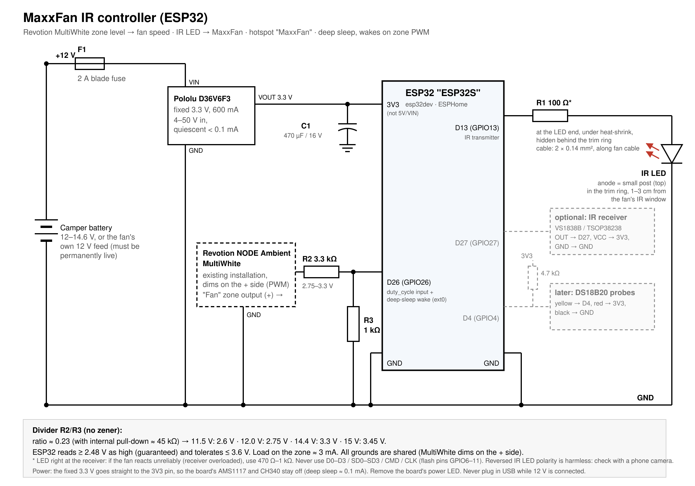

# MaxxFan IR controller for Revotion campers

An ESP32 with ESPHome controls a **MaxxAir MaxxFan Deluxe** roof fan over
infrared, the same way its remote does. The fan speed follows one dimmer zone
of a **Revotion NODE Ambient MultiWhite**, so the fan shows up in the Revotion
app as a "light" whose brightness is the fan speed, with no extra app and no
internet.

[](https://youtube.com/shorts/Wqia9TBAQzE)

▶ [Watch the video on YouTube](https://youtube.com/shorts/Wqia9TBAQzE)



> **Status:** running on the real fan in the camper (see the video).

## How it works

- **Revotion → ESP32:** the MultiWhite dims on the plus side with PWM. A
  3.3 kΩ / 1 kΩ divider turns its 12–14.4 V pulses into 2.75–3.3 V. The ESP32
  measures the duty cycle on GPIO26, which is a time ratio, so the battery
  voltage does not affect it.
- **ESP32 → fan:** an IR LED on GPIO13 sends the MaxxFan protocol through
  [esphome-maxxfan-protocol](https://github.com/brown-studios/esphome-maxxfan-protocol).
  Every message carries the complete state, like the original remote does.
  The fan never answers, so the ESP32 only knows what it sent last.
- **Deep sleep:** while the fan is off and the zone is at 0 %, the ESP32 goes
  to sleep after 30 minutes. The first PWM pulse on GPIO26 wakes it again;
  about 1 s later the fan has its command.
- **Hotspot:** whenever it is awake, the ESP32 opens a Wi-Fi hotspot called
  `MaxxFan`. Phones open the control page by themselves after joining (see
  [captive_redirect](#captive_redirect)).

### Zone level → fan

| Revotion zone | Fan | ESP32 |
|---|---|---|
| 0 % | off, cover closes | deep sleep after 30 min |
| 1–2 % | off | stays awake, hotspot on (for the web page or updates) |
| 3–10 % | 10 % | awake |
| 11–20 % | 20 % | awake |
| … | … | … |
| 91–100 % | 100 % | awake |

The last change wins: a speed set on the web page stays until the Revotion
slider moves again. After a restart, a dark zone does not switch off a fan
that is already running.

### Web page

`http://192.168.4.1/` on the `MaxxFan` hotspot:

| Entity | What it does |
|---|---|
| Fan | on/off and speed (10 steps) |
| Direction | Exhaust (air out) or Intake (air in) |
| Cover | open/close; fan on with cover closed is the "ceiling fan" mode |
| Mode | Manual, or Auto (the fan's own thermostat) |
| Auto temperature | thermostat setpoint in °C (sent to the fan in °F) |
| Send again | sends the current state again, e.g. after someone used the original remote |
| Beep | makes the fan beep twice: a quick IR range test that changes nothing |
| Revotion level | the measured zone level in % |

The page also shows the logs and takes firmware updates (upload
`maxxfan.ota.bin`).

## Parts

| Qty | Part | Use |
|---|---|---|
| 1 | ESP32 dev board (ESP32-WROOM-32, `esp32dev`) | controller |
| 1 | IR LED, 940 nm (5 mm) | sends to the fan |
| 1 | [Pololu D36V6F3](https://www.pololu.com/product/3791), fixed 3.3 V, 600 mA, 4–50 V in, quiescent < 0.1 mA | power for the ESP32 |
| 1 | capacitor 470 µF / 16 V (electrolytic) | buffers the Wi-Fi current peaks (C1) |
| 1 | resistor 100 Ω (470 Ω–1 kΩ if the LED sits right at the receiver, see below) | IR LED current |
| 1 | resistor 3.3 kΩ | divider top (R2) |
| 1 | resistor 1 kΩ | divider bottom (R3) |
| 1 | 2 A blade fuse + inline holder | 12 V feed |
| – | 2-core cable 2 × 0.14 mm², heat-shrink | IR LED lead |

Optional, not used by the firmware yet: a VS1838B/TSOP38238 IR receiver on
GPIO27 (to hear the original remote) and DS18B20 probes on GPIO4.

## Wiring

```
Camper +12 V ── fuse 2 A ── Pololu VIN   Pololu VOUT 3.3 V ──┬── ESP32 3V3
Camper GND   ────────────── Pololu GND ─────────────────────┼── ESP32 GND
                                                     470 µF ┘ (+ to 3V3)

MultiWhite "Fan" zone (+, PWM) ── 3.3 kΩ ──┬── GPIO26 (D26)
                                           └── 1 kΩ ── GND

GPIO13 (D13) ── 100 Ω ── IR LED anode   IR LED cathode ── GND
```

- The Pololu's fixed 3.3 V goes straight to the **3V3** pin, not to 5V/VIN.
  This leaves the board's own regulator (AMS1117) and USB chip (CH340)
  unpowered, which is most of the sleep current. Measure 3.3 V once before
  connecting the ESP32: the 3V3 pin has no protection.
- Put C1 right at the 3V3 and GND pins. Wi-Fi draws short peaks of up to
  about 400 mA; without it the voltage can dip low enough to reset the ESP32.
- Remove the board's power LED (desolder it or cut its trace). It would
  otherwise draw 1–2 mA all the time.
- **Never plug in USB while 12 V is connected.** USB then powers the 3.3 V
  rail through the AMS1117, against the Pololu. Disconnect 12 V for the
  first flash; later updates go over the hotspot.
- All grounds are shared. The MultiWhite dims on the plus side, so its zone
  output is a switched +12 V against the common camper ground.
- With the ESP32's internal pull-down (about 45 kΩ) in parallel to R3, the
  divider ratio is about 0.23: 12 V → 2.75 V, 14.4 V → 3.3 V, 15 V → 3.45 V.
  The ESP32 reads 2.48 V and up as high and tolerates up to 3.6 V.
- The pull-down keeps an unconnected input at 0 %, so a floating pin cannot
  switch the fan.
- Never use the pins labelled D0–D3, SD0–SD3, CMD or CLK: they are the flash
  pins GPIO6–11.

### Mounting the IR LED

The fan's IR receiver sits behind a small dark window in the inner trim ring,
near the buttons. To find it, cover spots with a finger while pressing the
remote.

1. Take off the inner trim ring (a few screws on the inside).
2. Drill a 5 mm hole (or 3 mm, matching the LED) **in the plastic ring only**,
   1–3 cm from the receiver window, and glue the LED in from behind so it
   points at the window. Do not cover the window, so the remote keeps
   working. Never drill the roof flange.
3. Put the 100 Ω resistor at the LED end under heat-shrink and lead the
   cable out through the roof opening, along the fan's own power cable.

At such a short distance the receiver can be overloaded. If the fan reacts
only sometimes, use 470 Ω–1 kΩ instead of 100 Ω. Reversed LED polarity is
harmless: a phone camera shows the LED flicker when you press "Beep".

The ESP32 and the regulator can sit in the ceiling cavity next to the
fan, powered from the fan's 12 V feed if that feed is permanently live. Then
only one thin signal wire runs from the MultiWhite.

### Revotion setup

Connect one MultiWhite zone output to the divider (no lamp is needed on it)
and name the zone "Fan" in the Revotion app. Its brightness is now the fan
speed, and Revotion scenes, schedules and the BRAIN integrations work with it
too.

## Power use

Measured at the 12 V battery, estimated:

| State | Current | Per day |
|---|---|---|
| awake, hotspot on | ~40 mA | ~1 Ah |
| deep sleep (Pololu, ESP32, power LED removed) | ~0.1–0.2 mA | < 0.005 Ah |

With a 5 V buck on 5V/VIN instead, the board's regulator and USB chip stay
powered and deep sleep takes 3–10 mA. While the fan runs it draws 0.2–3 A
itself, so the ESP32's share does not matter then.

## Building and flashing

1. Install ESPHome (tested with 2026.9.1):
   ```
   pipx install esphome
   ```
2. Copy `secrets.example.yaml` to `secrets.yaml` and set your own passwords.
   The hotspot password needs at least 8 characters.
3. Build:
   ```
   esphome compile maxxfan.yaml
   ```
   The images are in `.esphome/build/maxxfan/build/` (`firmware.factory.bin`,
   `firmware.ota.bin`).
4. First flash over USB, with the 12 V supply disconnected, e.g. with `esphome run maxxfan.yaml`, or from Chrome
   or Edge on [ESPHome Web](https://web.esphome.io/) with `firmware.factory.bin`.
5. Later updates: join the `MaxxFan` hotspot, open `http://192.168.4.1/` and
   upload `firmware.ota.bin`. The ESP32 must be awake: set the zone to 1–2 %.

Ready-made images are attached to the
[GitHub releases](../../releases). They are built from `secrets.example.yaml`,
so they use the example passwords listed in the release notes. Build your own
if you want different ones.

## captive_redirect

`components/captive_redirect/` is a small ESPHome component that makes phones
open the control page after joining the hotspot. It answers every DNS query
with the ESP32's address and redirects requests for other hosts (the phones'
internet checks, such as `connectivitycheck.gstatic.com` or
`captive.apple.com`) to `http://192.168.4.1/`.

ESPHome's own `captive_portal` does not fit here: it answers **every** request
with its Wi-Fi setup page, so the normal web page would never appear.

The phone will report "no internet", which is correct. Answer yes if it asks
whether to stay connected.

## Files

| File | Content |
|---|---|
| `maxxfan.yaml` | ESPHome configuration |
| `secrets.example.yaml` | template for `secrets.yaml` (not in git) |
| `components/captive_redirect/` | component that opens the web page on phones |
| `schaltplan_maxxfan.svg` / `.png` | schematic |

## Credits

- [brown-studios/esphome-maxxfan-protocol](https://github.com/brown-studios/esphome-maxxfan-protocol)
  (MIT), the MaxxFan IR protocol for ESPHome
- [skypeachblue/maxxfan-reversing](https://github.com/skypeachblue/maxxfan-reversing),
  the reverse engineering of the protocol
- Firmware and docs written with help from Claude (Anthropic)

MaxxAir and MaxxFan are trademarks of Airxcel; Revotion, NODE and BRAIN are
trademarks of REVOTION GmbH. This project is not affiliated with either.

## License

MIT, see [LICENSE](LICENSE).
